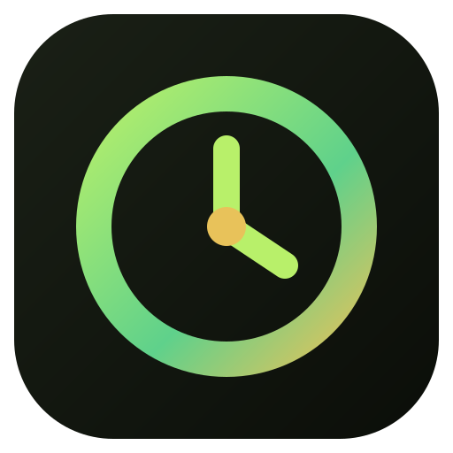

<p align="center"></p>

<h1 align="center">ZomboLens</h1>

<p align="center">Your <b>Project Zomboid</b> character's status in a small overlay, read from the network.<br>
<a href="README.es.md">Leer en español</a></p>

---

ZomboLens shows what the game's moodles and health panel tell you — hunger,
thirst, endurance, pain, wounds, bandages, nutrition… — as numbers and bars
in one overlay you can place anywhere, plus your own coordinates the way
admins type them.

It **only reads the network traffic your game receives and sends**. It never
touches the game, never reads its memory, needs no mod and works on vanilla
servers.

## What it does *not* show, on purpose

The server also sends some things the game deliberately hides from you —
your exact zombie infection level, for one. **ZomboLens never reads them**:
they are skipped in the decoder, not just hidden on screen. It shows what you
could already learn from the game's own UI, only more precisely and in one place.

## What it shows

| Mode | |
|---|---|
| **Basic** | Health, hunger, thirst, sleepiness, endurance, stress, panic, pain, boredom, unhappiness, wetness, temperature, and your position |
| **Extended** | Every stat (also anger, morale, sanity, fitness, drunkenness, nicotine withdrawal, sickness, food sickness, poison…), nutrition (calories, proteins, fats, carbs, weight), carry weight, walk/run speed, cold, active medicines |
| **Full** | Plus wounds per body part (bleeding, bites, scratches, lacerations, deep wounds, fractures, burns, glass, bullets, bandage left, stitches, splints) and estimated moodles |

Overall health is approximated from the 17 body parts (the game does not send
it). Moodles are estimated from the stats with the wiki's thresholds.

Minimize it to a small dot (it turns red while you bleed) and drag it anywhere.

## Install

### Linux

- **Debian / Ubuntu:** `sudo apt install ./ZomboLens_*.deb`
- **Fedora / openSUSE:** `sudo dnf install ./ZomboLens-*.rpm`
- **Arch / CachyOS / Manjaro:** `cd packaging/arch && makepkg -si`

The packages give the program the one permission it needs to read packets
(`CAP_NET_RAW`), so it never runs as root. Built by hand:
`sudo setcap cap_net_raw=ep /path/to/zombolens`.

**Hyprland** (Lua config) — float it, no focus on open:

```lua
hl.window_rule({ match = { class = "^([Zz]ombo[Ll]ens)$" }, float = true, no_initial_focus = true, no_blur = true, no_shadow = true, border_size = 0 })
```

On Hyprland the overlay follows the game: it shows on the game's workspace,
above the fullscreen game, and hides on the others.

### Windows

1. Install **[Npcap](https://npcap.com/#download)** with *“Install Npcap in
   WinPcap API-compatible Mode”* ticked.
2. Run the installer from [Releases](../../releases).

## Compatibility

Built and tested for **build 42.21**. Packet type numbers can shift when the
game adds packets; if a patch breaks it, the numbers in
[`src-tauri/src/pz.rs`](src-tauri/src/pz.rs) need updating.

## How it works

Project Zomboid talks **RakNet over UDP**, unencrypted. ZomboLens captures
UDP with libpcap/Npcap, rebuilds RakNet's split messages, finds the server by
the shape of its packets (no port setting needed) and decodes the character
messages the server sends you each second: `PlayerStats`, `PlayerHealth`,
`PlayerDamage`, `PlayerInjuries`, `PlayerEffects`; and your own movement
(`PlayerUpdateReliable`) for the position.

## Development

```bash
npm ci
npx tauri dev                     # or: cargo build in src-tauri
zombolens --replay capture.pcap   # replay a saved capture in real time
zombolens --dump capture.pcap     # decode a capture and print the final state
npm run preview                   # UI with fake data: http://localhost:8767
```

## Is it allowed?

ZomboLens is passive and shows only what the game already lets you see.
Still, every server has its own rules — check them, and use it at your own risk.

## License

GPL-3.0-only. Project Zomboid is a trademark of The Indie Stone; this project is not affiliated with them.
